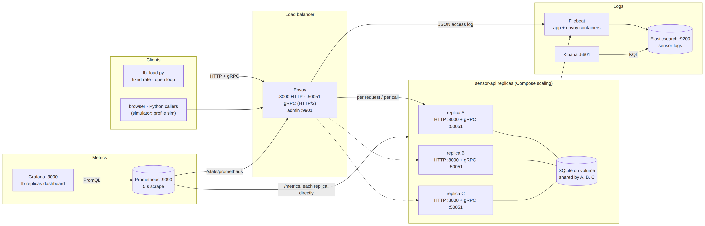
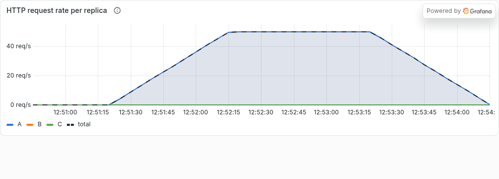
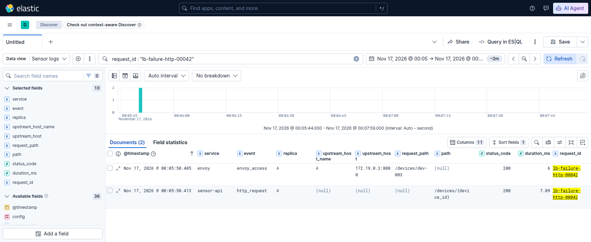
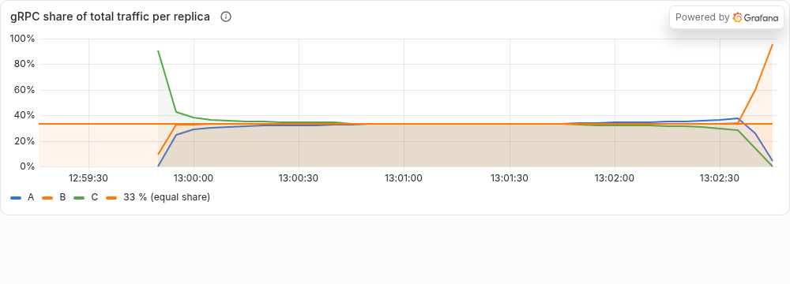
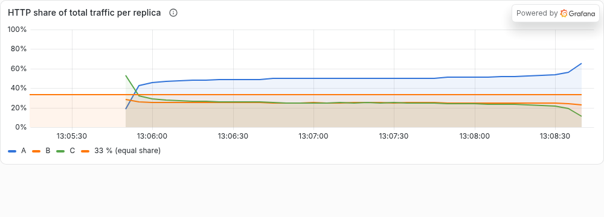
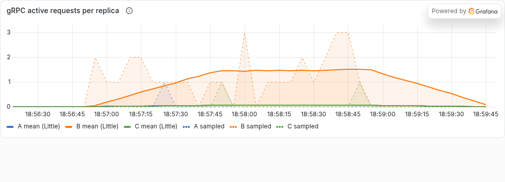
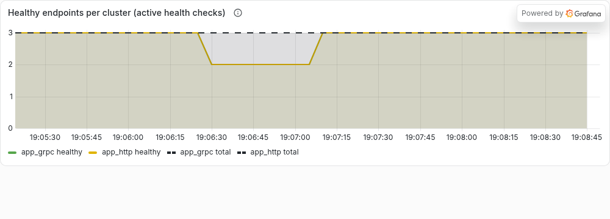
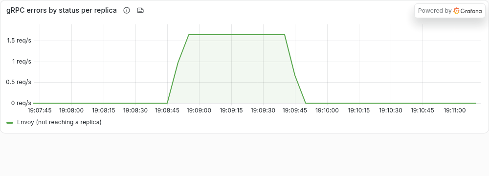
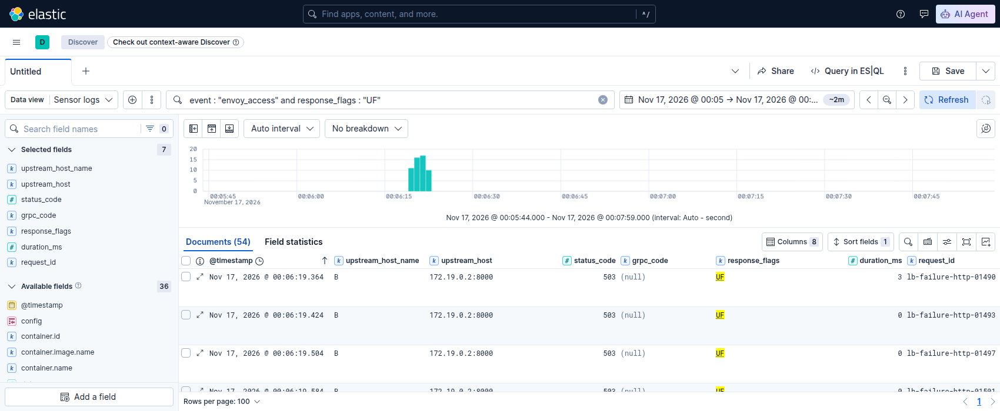

# IoT Sensor Ingestion Service: load balancing and observability

Enterprise Software Development, Fall 2026, Assignment 3. Individual submission by Muhammad Affan.

- **Extends Assignment 2**, which is frozen at git tag `a2-submission` (its report is `REPORT.md` at that tag; A1 is at `a1-submission`). This report covers only what A3 adds.
- **Run, experiment and recover:** [README.md](README.md). **Design decisions** A3-1…A3-17 (choice, reason, rejected alternative): [docs/DECISIONS.md](docs/DECISIONS.md). **Stage evidence** with commands and output: [docs/BUILD_LOG.md](docs/BUILD_LOG.md), sections A3-1…A3-7. **Raw results:** [docs/results/a3/](docs/results/a3/).
- **Run conditions:** one laptop (8 CPU threads, 7.7 GB RAM), Docker Compose, Envoy v1.40.2 with 2 worker threads. Workload for every run: **50 requests/s for 120 s, open loop, one interface at a time**, no client retries or circuit breaker, no Envoy retries. All times are UTC unless a caption says otherwise.

---

## A. Replicas and routing

### A.1 Architecture



Replicas A, B and C are one Compose service scaled to 3 (`esd_hw3-app-1…3`). Each is **one process** serving HTTP (:8000) and gRPC (:50051), so both interfaces share one metrics registry and one fault switch (A3-2).

Envoy is the only entry point: HTTP on :8000 and gRPC on :50051 (HTTP/2), admin on :9901. Its clusters come from a watched file, so `scripts/lb_policy.sh <phase>` switches policy without a restart (A3-9). Prometheus scrapes each replica and Envoy directly; Filebeat ships both sets of JSON logs to Elasticsearch.

### A.2 Replica identity and correlation

Scaled replicas share one environment, so each works out its name at start-up: a reverse-DNS lookup of its own IP returns `esd_hw3-app-2.esd_hw3_default`, and index 1/2/3 maps to A/B/C (A3-3). The name is on every log line (`replica`), in an `x-replica` response header or gRPC metadata, and in `sensor_replica_info`. It matches Prometheus's target label `replica` for all three. The **trace id is the request id**: the client's `x-request-id` is kept and logged by Envoy and by the replica (A3-5).

### A.3 Shared and per-replica state

| State | Where | Shared? | Evidence |
|---|---|---|---|
| Data (`readings`, `devices`) | One SQLite file on the `sensor-data` volume | **Shared** by A, B, C | The same `GET /devices/{id}` answer from every replica |
| Idempotency records | The same table: unique index on `(device_id, recorded_at)` | **Shared** | One reading sent 3× through round robin: 201 from A (id 13), then 200 *replayed* from B twice; the same key with a new value got 409 from C ([a_idempotency_cross_replica.txt](docs/results/a3/a_idempotency_cross_replica.txt)) |
| Rate-limit buckets | Token bucket in each process's memory (`app/ratelimit.py`) | **Per replica** | A burst of 7 for one device: A-only gives 5 × 201 then 2 × 429; round robin gives **7 × 201** ([a_rate_limit_per_replica.txt](docs/results/a3/a_rate_limit_per_replica.txt)) |

**What goes wrong with per-replica buckets:** behind round robin a device gets a burst of 5 *per replica*, i.e. 15 at once and 3 req/s, three times the configured limit, and the limit changes with the replica count. A shared store (SQLite, Redis) or consistent hashing on `device_id` would fix it; A3 keeps the buckets and documents the effect (A3-4).

### A.4 Test traffic

HTTP **`GET /devices/{device_id}`** and gRPC **`GetDevice`** (a unary call added to the A2 service), with the same query and status rule. Being read-only, they avoid 429s and the SQLite write lock, so only the balancer differs between runs (A3-1).

---

## B. Baseline: A only

### B.1 Dashboard and queries

Dashboard **"Load balancing · per replica"** (uid `lb-replicas`, exported at [monitoring/grafana/dashboards/lb-replicas.json](monitoring/grafana/dashboards/lb-replicas.json)) has one row per interface plus an Envoy row. All panels use a **1-minute window**, which is at least 4× the 5 s scrape interval.

| Panel (per replica) | PromQL (HTTP; gRPC uses `sensor_grpc_*{method="GetDevice"}` and `code`) |
|---|---|
| Request rate | `sum by (replica) (rate(sensor_http_requests_total{route="/devices/{device_id}"}[1m]))` |
| Share of total | the same, `/ ignoring (replica) group_left sum(rate(…[1m]))`, with a dashed 1/3 line |
| Active requests | `sum by (replica) (rate(sensor_http_request_duration_seconds_sum{…}[1m]))`: mean in flight by Little's law. The sampled `*_in_progress` gauge is shown dotted |
| p50 / p95 | `histogram_quantile(q, sum by (replica, le) (rate(…_bucket{…}[1m])))` |
| Errors by status | `sum by (replica, status_code) (rate(…{status_code!~"2.."}[1m])) > 0`, plus Envoy-only failures: `rate(envoy_cluster_upstream_rq_pending_failure_eject[1m])` + upstream timeouts |
| Envoy | `envoy_cluster_endpoint_rq_total`, `envoy_cluster_membership_healthy`, health-check and connect failures |

Labels are small fixed sets (`replica`, route/method, status, Envoy's endpoint hostname); request ids stay in logs. Active requests use Little's law because the sampled gauge rarely catches a 3 ms call, and for HTTP it counts the `/metrics` scrape itself. Per-run numbers (`scripts/lb_run_stats.py`) sum raw samples over the run's range, since `increase()` extrapolates (1000 requests read as 1144, A3-15).

### B.2 Result

| Interface | Rate | Sent | Successes | Failures | Client p95 | A / B / C |
|---|---|---|---|---|---|---|
| HTTP | 50.01/s | 6000 | 6000 | 0 | 10.4 ms | 6000 / 0 / 0 |
| gRPC | 50.01/s | 6000 | 6000 | 0 | 9.5 ms | 6000 / 0 / 0 |



*Only A has traffic: 50 req/s (the ramps are the `[1m]` window filling and emptying). B and C stay at 0 although they run and pass health checks.* gRPC: [b_baseline_grpc_rate.png](docs/screenshots/a3/b_baseline_grpc_rate.png).

A's server p95 was 9.7 ms (HTTP) and 4.8 ms (gRPC) with 0.27 and 0.12 requests in flight: one replica is far from busy at 50 req/s. Client p95 adds 1–5 ms for Envoy, the client and the network.

### B.3 Envoy event and replica event together

One KQL query, `request_id : "<id>"`, returns Envoy's `envoy_access` event and the replica's own event (saved searches `sensor-envoy-http` / `sensor-envoy-grpc`).



*Times in PKT (UTC+5). Envoy's line names the endpoint it picked (`upstream_host_name` A) and the replica that answered (`replica` A); A's own line follows 8 ms later with its 7.09 ms duration.* gRPC: [b_kibana_grpc_envoy_and_replica.png](docs/screenshots/a3/b_kibana_grpc_envoy_and_replica.png).

The two proxy/backend log examples, as stored ([b_log_correlation.txt](docs/results/a3/b_log_correlation.txt), baseline run):

```json
{"service":"envoy","event":"envoy_access","replica":"A","upstream_host_name":"A","upstream_host":"172.19.0.3:8000","request_path":"/devices/dev-003","status_code":200,"duration_ms":6,"upstream_ms":"5","request_id":"lb-baseline-http-00042"}
{"service":"sensor-api","event":"http_request","replica":"A","path":"/devices/{device_id}","status_code":200,"duration_ms":6.28,"request_id":"lb-baseline-http-00042"}
{"service":"envoy","event":"envoy_access","replica":"A","upstream_host":"172.19.0.3:50051","request_path":"/sensor.v1.IngestService/GetDevice","status_code":200,"grpc_code":"OK","duration_ms":6,"request_id":"lb-baseline-grpc-00042"}
{"service":"sensor-api","event":"grpc_request","replica":"A","rpc_method":"GetDevice","grpc_code":"OK","duration_ms":2.84,"request_id":"lb-baseline-grpc-00042"}
```

---

## C. Round robin

`lb_policy.sh round-robin` adds B and C (weight 1) to both clusters.

| Interface | A / B / C requests | Shares | Client p95 | Server p95 (each) |
|---|---|---|---|---|
| HTTP | 2001 / 2000 / 1999 | 33.4 / 33.3 / 33.3 % | 10.0 ms | 9.7 ms |
| gRPC | 2000 / 2000 / 2000 | 33.3 / 33.3 / 33.3 % | 9.1 ms | 4.8 ms |



*All three shares sit on the dashed 33 % line; the edge spikes are the ratio of near-zero rates as the window fills.* HTTP: [c_round_robin_http_share.png](docs/screenshots/a3/c_round_robin_http_share.png).

**Versus 33 %:** gRPC's one connection sits on one Envoy worker, which cycles A→B→C exactly. HTTP opens a connection per request and Envoy's two workers keep separate RR positions, hence ±1 (A3-16). **Versus the baseline:** latency is unchanged (same server p95, client p95 within 0.5 ms), because one replica was not loaded; A's in-flight fell from 0.27 to 0.09. What changed is spare capacity, not speed.

**gRPC needs HTTP/2 routing:** through a `tcp_proxy` listener on the same cluster, each one-channel client run went 100 % to one replica (B, C, C); the HTTP/2 listener split it 334/333/333 ([c_grpc_tcp_vs_http2.txt](docs/results/a3/c_grpc_tcp_vs_http2.txt)).

---

## D. Experiments

### D.1 Health checks and conditions

| Setting | HTTP cluster | gRPC cluster |
|---|---|---|
| Check | `GET /health` → 200 | `grpc.health.v1` `Check("")` → SERVING |
| Interval / no-traffic interval | 2 s / 2 s | 2 s / 2 s |
| Timeout | 1 s | 1 s |
| Unhealthy / healthy threshold | 2 / 2 | 2 / 2 |
| Connect timeout · DNS refresh | 1 s · 5 s | 1 s · 5 s |
| Retries · outlier detection · circuit breakers | none · none · Envoy defaults (1024, never reached) | same |

Each experiment started from round robin and was undone afterwards. Predictions were written before the runs and never edited ([d_predictions.md](docs/results/a3/d_predictions.md)).

### D.2 Weighted round robin 2:1:1

- **Prediction:** 50/25/25; no latency change; A has about 2× the requests in flight.
- **Observed:** HTTP 3001/1500/1499, gRPC 3000/1500/1500 (50/25/25 %). In flight: A 0.166 vs 0.084/0.083 (HTTP), 0.067 vs 0.034/0.035 (gRPC), i.e. 2×. Server p95 unchanged; client p95 12.7 / 11.2 ms.



*A holds 50 %, B and C overlap at 25 %.* Active requests: [d_weighted_http_active.png](docs/screenshots/a3/d_weighted_http_active.png).

- **Explanation:** a weight moves work, it doesn't add capacity. A at 25 req/s is still mostly idle, so its service time is unchanged and its in-flight count doubles (Little's law). The 2 ms client-p95 rise appears in no replica's p95, so it came from outside them (proxy, client or a memory-short host), not from the weights. Near saturation, double traffic would raise A's queueing, not its throughput.

### D.3 Least request vs round robin, B delayed by 200 ms

B gets a 200 ms delay on both interfaces; the same workload runs under round robin and under least request (Envoy's "power of two choices": pick 2 hosts at random, use the one with fewer active requests).

| Run | Interface | A / B / C share | B in flight (mean) | Client p50 / p95 / mean |
|---|---|---|---|---|
| Round robin | HTTP | 33.3 / 33.3 / 33.3 % | 3.45 | 10.9 / 212.0 / 76.8 ms |
| Round robin | gRPC | 33.3 / 33.3 / 33.3 % | 3.38 | 9.9 / 210.9 / 75.9 ms |
| Least request | HTTP | 43.0 / **13.8** / 43.3 % | **1.42** | 9.3 / 210.6 / **36.5** ms |
| Least request | gRPC | 42.9 / **14.5** / 42.6 % | **1.47** | 9.1 / 210.1 / **37.8** ms |



*Least request: B's mean in flight stays near 1.5, A and C near 0.05.* Round robin: [d_delay_rr_grpc_active.png](docs/screenshots/a3/d_delay_rr_grpc_active.png) (B ≈ 3.4). Shares: [RR](docs/screenshots/a3/d_delay_rr_http_share.png) vs [LR](docs/screenshots/a3/d_delay_lr_http_share.png).

- **Prediction:** RR: B 33 %, ≈ 3.3 in flight, p95 ≈ 205 ms. LR: B ≈ 10 %, ≈ 1 in flight, **p95 still ≈ 200 ms**, mean lower.
- **Observed:** RR as predicted. LR: B 14 %, in flight 2.4× lower, mean halved, p95 unchanged.
- **Explanation:** RR ignores load, so B keeps a third and queues 16.7/s × 0.2 s ≈ 3.4. LR avoids B whenever the other draw is less busy; B still wins when both draws are B (1/9) or on ties, so 14 % rather than 10 %. With 14 % > 5 % of requests slow, the 95th percentile is still a slow one. **B passed every health check throughout**: health checks can't see a slow replica. (B's server p95 reads 242.5 ms vs a true ≈ 205 ms: interpolation inside the 100–250 ms bucket.)

### D.4 Failure and recovery

Round robin, no delay: `docker stop esd_hw3-app-2` at 30 s, `docker start` at 70 s; `scripts/lb_failure.py` polled Envoy's `/clusters` every 250 ms.

| | HTTP | gRPC |
|---|---|---|
| B removed (unhealthy) after `docker stop` issued | **3.6 s** | **6.0 s** |
| Client errors | 54 × 503 (0.90 %) | 92 × `UNAVAILABLE` (1.53 %) |
| B's own `/health` OK after `docker start` | 2.1 s | 1.6 s |
| B healthy in Envoy after `docker start` | **4.8 s** | **4.4 s** |
| A / B / C over the run | 39.4 / 21.2 / 39.4 % | 39.3 / 21.4 / 39.3 % |

Client timeline (HTTP): at t = 29–32 s about 17 of 50 requests/s failed (B's third), some after ≈ 0.9 s; from t = 33 s A and C took 25/s each with no errors; B rejoined at t = 74 s, also without errors.



*Healthy endpoints drop from 3 to 2 after B's second failed check and return a few seconds after restart (both clusters together: one container serves both).*



*No replica saw an error: the failed calls never reached one. Envoy's `upstream_rq_pending_failure_eject` plateaus at ≈ 1.5/s over 1 min, i.e. the 92 failures, sent as `UNAVAILABLE` inside HTTP 200, invisible to an HTTP-5xx count.* HTTP: [d_failure_http_errors.png](docs/screenshots/a3/d_failure_http_errors.png); rate: [d_failure_http_rate.png](docs/screenshots/a3/d_failure_http_rate.png) (the `[1m]` window smooths the 4 s gap, so the timeline above is the precise view).



*`response_flags : "UF"` finds the 54 503s Envoy sent to B's address (times in PKT); none has a replica log line.*

**Timings vs settings.** Removal needs 2 failed checks. HTTP: B exited 1.1 s after `stop` and the checks were refused at once, so it was out 2.5 s later, consistent with two checks 2 s apart. gRPC: with the container gone its IP stopped answering, so checks **timed out**; each failure then costs timeout + interval = 3 s, and two take 4–6 s (6.0 s), which my 2–4 s prediction missed. Until removal every request to B failed: errors ≈ ⅓ × 50/s × removal time (54, 92). Recovery = start-up (1.6–2.1 s) + two passing checks ≈ 4.4–4.8 s, within the predicted 4–7 s, with no errors. A shorter interval, or one Envoy retry on connect failure (safe for read-only calls), would lose fewer requests.

### D.5 All runs

From [summary.md](docs/results/a3/summary.md). Shares (of successes) equal Prometheus's and Envoy's per-endpoint counts in every run.

| Run / interface | Policy and fault | Target / actual req/s | A / B / C | Client p95 | Errors | Explanation |
|---|---|---|---|---|---|---|
| B baseline · HTTP | A only | 50 / 50.01 | 100 / 0 / 0 | 10.4 ms | 0 % | Only A is a destination |
| B baseline · gRPC | A only | 50 / 50.01 | 100 / 0 / 0 | 9.5 ms | 0 % | 〃 |
| C round robin · HTTP | RR 1:1:1 | 50 / 50.01 | 33.4 / 33.3 / 33.3 | 10.0 ms | 0 % | ±1 from two workers' RR cycles |
| C round robin · gRPC | RR 1:1:1 | 50 / 50.01 | 33.3 / 33.3 / 33.3 | 9.1 ms | 0 % | Per-call routing over one connection |
| D1 weighted · HTTP | RR 2:1:1 | 50 / 50.01 | 50.0 / 25.0 / 25.0 | 12.7 ms | 0 % | A has 2× in flight; replicas not slower |
| D1 weighted · gRPC | RR 2:1:1 | 50 / 50.01 | 50.0 / 25.0 / 25.0 | 11.2 ms | 0 % | 〃 |
| D2 delay · RR · HTTP | RR, B +200 ms | 50 / 50.01 | 33.3 / 33.3 / 33.3 | 212.0 ms | 0 % | RR ignores B's queue (3.4 in flight) |
| D2 delay · RR · gRPC | RR, B +200 ms | 50 / 50.01 | 33.3 / 33.3 / 33.3 | 210.9 ms | 0 % | 〃 |
| D2 delay · LR · HTTP | least request, B +200 ms | 50 / 50.01 | 43.0 / 13.8 / 43.3 | 210.6 ms | 0 % | B avoided; still > 5 % slow, so p95 unchanged; mean halved |
| D2 delay · LR · gRPC | least request, B +200 ms | 50 / 50.01 | 42.9 / 14.5 / 42.6 | 210.1 ms | 0 % | 〃 |
| D3 failure · HTTP | RR, B stopped 30–70 s | 50 / 50.01 | 39.4 / 21.2 / 39.4 | 11.0 ms | 0.90 % | Errors until 2 failed checks (3.6 s) |
| D3 failure · gRPC | RR, B stopped 30–70 s | 50 / 50.01 | 39.3 / 21.4 / 39.3 | 10.1 ms | 1.53 % | Timed-out checks: 6.0 s to remove |

### D.6 Cross-check with Envoy's access logs

Weighted HTTP run (13:05:44–13:07:44): request ids `lb-weighted-http-*` grouped by Envoy's `upstream_host_name` give **A 3001 / B 1500 / C 1499**, equal to the client, Prometheus and the replicas' own events ([d_weighted_http_access_log.json](docs/results/a3/d_weighted_http_access_log.json), `scripts/lb_es_check.py`). It holds for the failure run too (B: 1314 = 1260 OK + 54 `UF`). The check counts distinct ids, because a since-fixed Filebeat bug had re-shipped Envoy's log (24000 documents for 6000 requests, BUILD_LOG A3-5).

---

## Conclusions

1. **Least request for both interfaces, and for gRPC only on the HTTP/2 listener.** With healthy, identical replicas round robin was exact (33.3 %), so LR loses nothing; with one slow replica RR kept a third of traffic on it (3.4 queued, mean 77 ms) while LR cut B to 14 %, its queue to 1.4 and the mean to 37 ms on both interfaces. gRPC must be routed per call: `tcp_proxy` pinned a client 100 % to one replica. Neither policy fixed p95 (≈ 210 ms); that needs the slow host ejected (outlier detection), since health checks kept passing.
2. **Differently:** if replicas keep per-device state in memory, like our rate-limit buckets, I'd use **consistent hashing on `device_id`** (ring hash or Maglev), so each device keeps one bucket; LR would spread a device over all replicas and triple its limit (A.3).
3. **If Envoy stops**, every call fails with connection refused although A, B and C are healthy, and Prometheus shows idle replicas, not errors: Envoy is a single point of failure. Improvement: two Envoys behind a floating virtual IP (keepalived/VRRP), or several proxy pods behind a Kubernetes Service, plus an alert on Envoy's `up` and on client errors.

## Credits and AI assistance

- Written with the help of Claude Code (Anthropic), which implemented the code and ran the experiments to my design decisions ([docs/DECISIONS.md](docs/DECISIONS.md)). I reviewed the code and checked the outputs recorded here.
- Reused: my own A1 and A2 code (tags `a1-submission`, `a2-submission`): the API, gRPC service, metrics, logging pipeline and the A1 load-script helpers.
- References: Envoy documentation on load balancing (round robin, weighted, least request, power of two choices), active health checking, the HTTP connection manager and `tcp_proxy`; Docker Compose documentation on service scaling; the gRPC health checking protocol (`grpc.health.v1`).
- Libraries and tools: FastAPI, Uvicorn, Pydantic, grpcio / grpcio-health-checking / protobuf, prometheus_client, pytest, Envoy, Prometheus, Grafana, Filebeat, Elasticsearch, Kibana.
